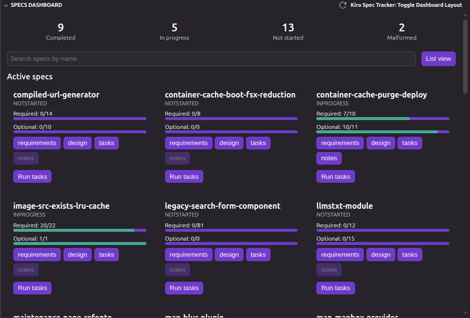
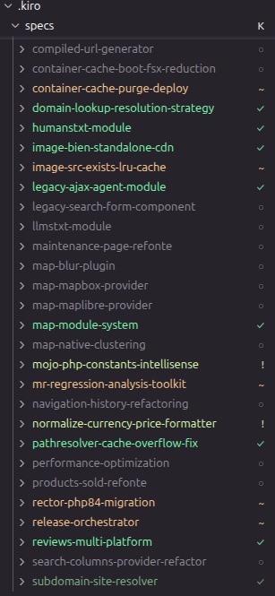

# Kiro Spec Tracker

Kiro Spec Tracker reads the [Kiro](https://kiro.dev) specs in your workspace
(`.kiro/specs/<name>/`) and surfaces their progress across the IDE: status badges in the
file explorer, a dedicated dashboard in the activity bar, and quick entry points to open
or run a spec. It is read-only, fully local, and ships no telemetry and no network calls.

## Table of contents

- [Features](#features)
- [Screenshots](#screenshots)
- [How progress is computed](#how-progress-is-computed)
- [Usage](#usage)
- [Settings](#settings)
- [Security and privacy](#security-and-privacy)
- [Requirements](#requirements)
- [Contributing](#contributing)
- [License](#license)

## Features

- **Explorer decorations** — each spec folder under `.kiro/specs/` and the `.kiro/specs/`
  folder itself gets a short status badge, a theme color, and a tooltip summarizing its
  required and optional progress.
- **Dashboard view** — a dedicated activity-bar webview listing every spec with its status,
  a required-progress bar and percentage, the optional progress shown separately, a search
  box, aggregate statistics, and list or grid layouts. Completed specs are set apart but
  stay visible. Each spec links to its `requirements.md`, `design.md`, `tasks.md` and
  `notes.md` when present.
- **Specs-by-status tree** — a lightweight activity-bar tree grouping specs by status for
  quick navigation.
- **Run tasks (honest MVP)** — from the dashboard, the explorer context menu on a spec
  folder, or the Command Palette, open a spec's `tasks.md` and, only with your explicit
  consent, copy a ready-to-paste execution prompt to the clipboard.

## Screenshots

The activity-bar dashboard with per-spec status, progress bars and statistics:

Status badges applied to spec folders in the file explorer:

## How progress is computed

A spec lives in `.kiro/specs/<name>/` and must contain a `tasks.md`. Task status is read
only from the GitHub-Flavored-Markdown checkboxes in `tasks.md`: `- [ ]` (not done) and
`- [x]` (done). A task is **optional** when an asterisk is glued to its checkbox
(`- [ ]* 1.2`); the word "optional" in prose is never treated as a marker. Only leaf tasks
are counted, so a parent is never double-counted with its sub-tasks.

The extension exposes two **separate** progress ratios, never merged into one number:
required (`required done / required total`) and optional (`optional done / optional
total`). Each spec resolves to one of five states:

| State            | Meaning                                                               |
| ---------------- | --------------------------------------------------------------------- |
| `Malformed`      | `tasks.md` is missing or unreadable, or a required document is absent |
| `NotStarted`     | `tasks.md` is present and no task is done                             |
| `InProgress`     | at least one task done, but not all required tasks                    |
| `Completed`      | all required tasks done (optional tasks ignored)                      |
| `FullyCompleted` | all required and all optional tasks done                              |

The full model is documented in the project steering file `kiro-spec-format.md`.

## Usage

1. Open a workspace that contains one or more `.kiro/specs/<name>/` folders.
2. Open the **Kiro Spec Tracker** view from the activity bar to see the dashboard.
3. Browse the file explorer to see per-spec status badges.
4. Use the Command Palette (`Kiro Spec Tracker: ...`) or the explorer context menu on a
   spec folder to refresh, toggle the dashboard layout, or run a spec's tasks.

## Settings

The extension works with no configuration. Settings that tune which documents make a spec
`Malformed` and other behaviors are documented in the extension's contribution points.

## Security and privacy

- No network request, no telemetry.
- Spec content is treated as untrusted data and never evaluated as code.
- The dashboard webview enforces a strict Content Security Policy with a per-render nonce,
  loads only local bundled resources, and renders spec text as plain text.

See [PRIVACY.md](PRIVACY.md) for details.

## Requirements

- An IDE compatible with the VS Code extension API (VS Code `^1.85.0`), such as Kiro.

## Contributing

Contributions are welcome. See [CONTRIBUTING.md](CONTRIBUTING.md) for setup, conventions,
tests, and the pull request process.

## License

[MIT](LICENSE) © ducks-project
