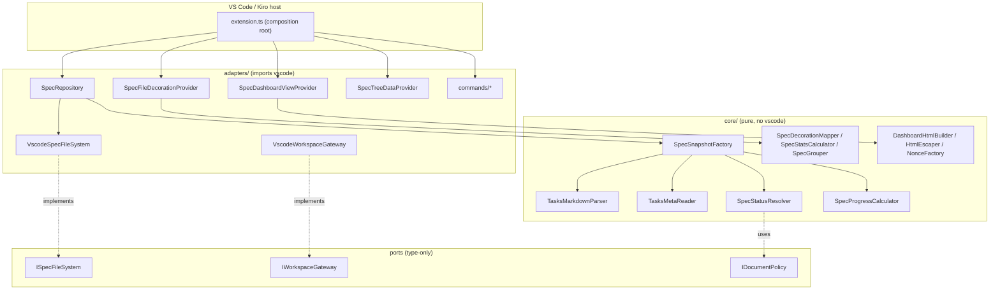
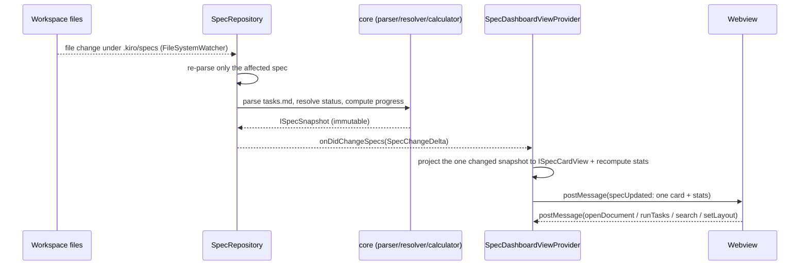
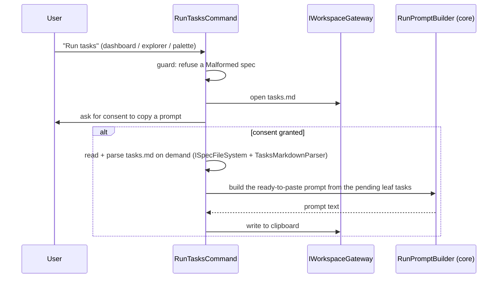

# Architecture

Kiro Spec Tracker is structured in layers to isolate the business logic from the editor
API. The goal: a core that is testable without a VS Code host, portable (web), and a single
boundary with `vscode`.

## Layers

- Core (`core/`): pure logic. Never imports `vscode`. Contains the `tasks.md` parser, the
  tolerant meta reader, the status resolver, the progress calculator, the stats and
  decoration mappers, the dashboard view projectors (card view, stat toggles, layout
  toggles), the additive status-filter state machine and card-visibility composer, the
  tree-item context-value builder, the HTML escaper and nonce factory, and the immutable
  value objects.
- Ports (`core/ports/` and `adapters/ports/`): interfaces describing what each side needs
  ([IDocumentPolicy](../src/core/ports/IDocumentPolicy.ts),
  [IScheduler](../src/core/ports/IScheduler.ts),
  [IRandomSource](../src/core/ports/IRandomSource.ts),
  [ISpecFileSystem](../src/adapters/ports/ISpecFileSystem.ts),
  [IWorkspaceGateway](../src/adapters/ports/IWorkspaceGateway.ts)).
- Adapters (`adapters/`): the only layer that imports `vscode`. Implements the ports, reads
  the file system, decorates the explorer, hosts the dashboard webview and the tree view,
  and registers the commands.
- Entry point ([extension.ts](../src/extension.ts)): composition root that wires the
  dependencies and registers everything into `context.subscriptions`.

## Layer diagram

## Dashboard flow

`onDidChangeSpecs` carries a fine-grained `SpecChangeDelta`
([ISpecChangeDelta](../src/core/model/ISpecChangeDelta.ts)): a `specChanged` delta names the
single changed `folderPath`, while a `fullRefresh` delta marks a full rediscovery. On mount
or a `fullRefresh` the provider sends a `render` message carrying every card; on a
`specChanged` it sends an incremental `specUpdated` message carrying only the one
[ISpecCardView](../src/core/model/ISpecCardView.ts) plus the recomputed aggregate stats. The
webview keeps a `Map` of mounted card nodes keyed by `folderPath` and replaces only the
changed node, so a single edit no longer reprocesses or re-renders all N specs.

## Dashboard interactions (filtering, toggles, tree menu)

The dashboard's status filter is a pure, client-side view concern layered over the card
view-models the webview has already received; it never triggers an extension-host round-trip
or a full re-render. The clickable statistics are additive toggle filters backed by the
immutable [SpecStatusFilter](../src/core/status/SpecStatusFilter.ts) state machine (toggle a
key to add it, toggle again to remove it; an empty set shows everything). Card visibility
composes that status filter with the free-text search through
[SpecCardFilter](../src/core/status/SpecCardFilter.ts) (a logical AND). The header toggles,
their pressed state and the list/grid icon toggles are projected by the pure
[SpecStatToggleView](../src/core/status/SpecStatToggleView.ts) and
[SpecLayoutToggleView](../src/core/status/SpecLayoutToggleView.ts); the webview only renders
the decision and persists the active filter keys and layout in its own `setState`. Keeping
the state machine and the mappings in `core/` makes the least-covered DOM/CSS layer thin and
the logic unit- and property-testable without a VS Code host.

The "Specs by Status" tree view contributes a declarative `view/item/context` menu (open
requirements/design/tasks/notes and run tasks). Each spec tree item carries a `contextValue`
built by the pure [buildSpecTreeContextValue](../src/core/status/SpecTreeContextValue.ts):
a `spec` base token, one `doc-<kind>` token per present document, and a `runnable` token for
a non-malformed spec. The package.json `when` clauses match these tokens with regular
expressions, so an action whose document is absent is hidden and "Run tasks" is hidden for a
malformed spec. The menu commands are thin, tree-item-aware wrappers registered in
`extension.ts`; they resolve the targeted spec from the node argument and reuse the existing
`OpenDocumentCommand` and `RunTasksCommand` (the latter already refuses a malformed spec), so
no behaviour is duplicated.

## Run-tasks flow (MVP)

Since 0.3.0 the snapshot no longer caches the parsed task tree, so `RunTasksCommand` parses
`tasks.md` on demand through the `ISpecFileSystem` port and `TasksMarkdownParser` when the
user actually runs a spec, then derives the pending leaf titles for the prompt. It is the
only consumer of the full task tree, which keeps the retained dashboard data lean.

## Patterns

- Dependency Inversion: the core depends on ports (`IDocumentPolicy`, `IScheduler`,
  `IRandomSource`), and the adapters implement the file-system and workspace ports. The
  core never references a concrete adapter.
- Tolerant parsing: [TasksMarkdownParser](../src/core/parsing/TasksMarkdownParser.ts) and
  [TasksMetaReader](../src/core/parsing/TasksMetaReader.ts) never throw on bad input; they
  skip unparseable lines and return an empty meta on invalid JSON.
- Immutable value objects: [ISpecSnapshot](../src/core/model/ISpecSnapshot.ts) is the plain,
  serializable contract that crosses both the layer boundary and the `postMessage` boundary,
  so the webview holds no `vscode` object and the core holds no webview state.
- Single-responsibility helpers: badge/color/tooltip, stats, grouping, HTML/CSP/nonce and
  prompt building each live in their own pure core class, kept out of the host-only
  providers.
- Observer with a fine-grained payload: `SpecRepository.onDidChangeSpecs` notifies its
  listeners with a `SpecChangeDelta` ([ISpecChangeDelta](../src/core/model/ISpecChangeDelta.ts))
  rather than a payloadless "something changed" signal, so the dashboard and the decoration
  providers react to only the changed spec instead of reprocessing the whole workspace.
- DTO / view-model projection: [SpecCardViewMapper](../src/core/status/SpecCardViewMapper.ts)
  projects a full [ISpecSnapshot](../src/core/model/ISpecSnapshot.ts) onto the lean
  [ISpecCardView](../src/core/model/ISpecCardView.ts) the webview consumes, dropping the task
  tree so each `postMessage` payload stays small.
- Bounded-concurrency iterator: [mapWithLimit](../src/core/BoundedMap.ts) is a pure,
  order-preserving worker-pool used by `SpecRepository` discovery to cap the number of
  in-flight spec reads, smoothing cold-scan tail latency and file-handle pressure without
  changing the result.
- Immutable state machine: [SpecStatusFilter](../src/core/status/SpecStatusFilter.ts) models
  the additive status-filter selection as an immutable value object (every toggle returns a
  new instance), composed with the search by [SpecCardFilter](../src/core/status/SpecCardFilter.ts).
  The pure decision is unit- and property-tested, and the webview DOM only applies it.

## Security boundary

- Only `adapters/` and `extension.ts` import `vscode`; `core/` is pure and portable.
- The dashboard webview uses a strict Content Security Policy with a per-render nonce, loads
  only local bundled resources, and renders untrusted spec text as plain text.
- No network, no telemetry, no evaluation of spec or configuration content as code.
