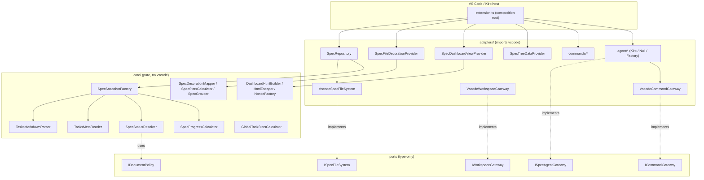
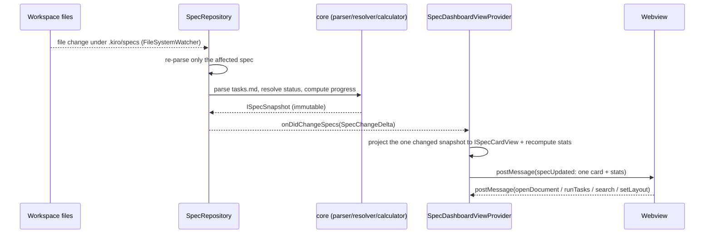
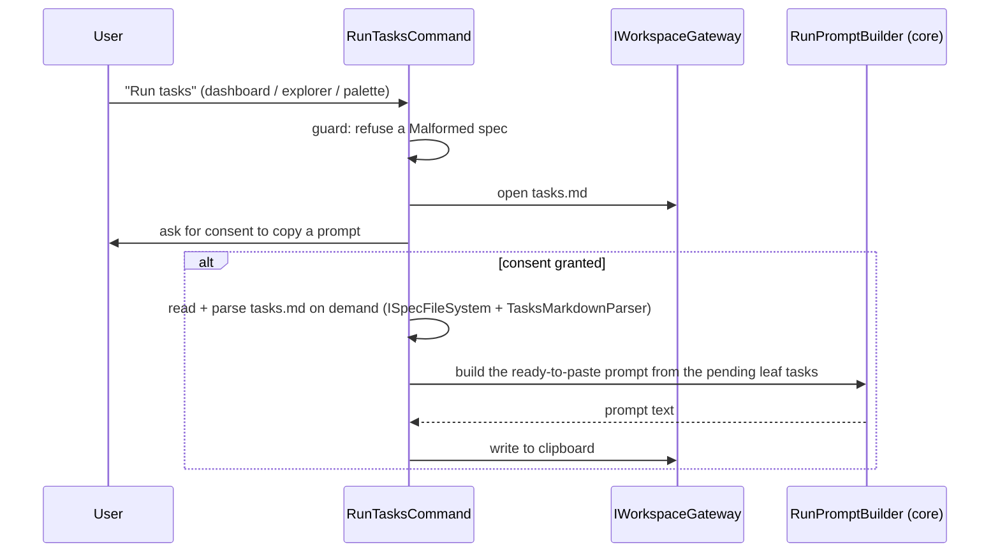
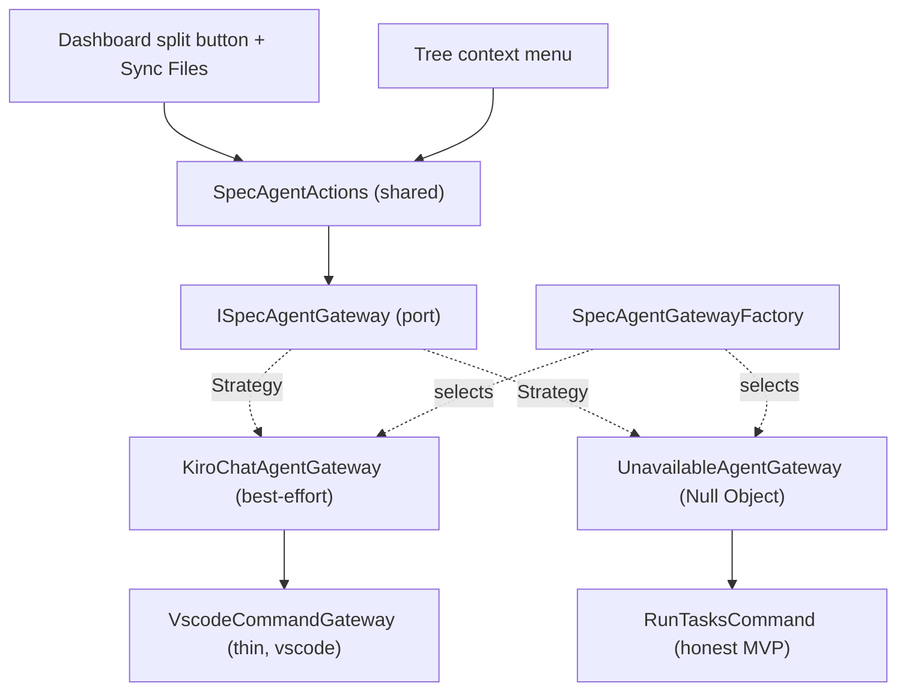

# Architecture

Kiro Spec Tracker is structured in layers to isolate the business logic from the editor
API. The goal: a core that is testable without a VS Code host, portable (web), and a single
boundary with `vscode`.

## Layers

- Core (`core/`): pure logic. Never imports `vscode`. Contains the `tasks.md` parser, the
  tolerant meta reader, the status resolver, the progress calculator, the per-spec stats and
  decoration mappers, the global task-level statistics calculator, the dashboard view
  projectors (card view, stat toggles, layout toggles, folder-filter options and menu), the
  additive status-filter and folder-filter state machines and card-visibility composer, the
  tree-item context-value builder, the HTML escaper and nonce factory, and the immutable value
  objects.
- Ports (`core/ports/` and `adapters/ports/`): interfaces describing what each side needs
  ([IDocumentPolicy](../src/core/ports/IDocumentPolicy.ts),
  [IScheduler](../src/core/ports/IScheduler.ts),
  [IRandomSource](../src/core/ports/IRandomSource.ts),
  [ISpecAgentGateway](../src/core/ports/ISpecAgentGateway.ts),
  [ISpecFileSystem](../src/adapters/ports/ISpecFileSystem.ts),
  [IWorkspaceGateway](../src/adapters/ports/IWorkspaceGateway.ts),
  [ICommandGateway](../src/adapters/ports/ICommandGateway.ts),
  [IAgentErrorReporter](../src/adapters/ports/IAgentErrorReporter.ts)).
- Adapters (`adapters/`): the only layer that imports `vscode`. Implements the ports, reads
  the file system, decorates the explorer, hosts the dashboard webview and the tree view,
  and registers the commands.
- Entry point ([extension.ts](../src/extension.ts)): composition root that wires the
  dependencies and registers everything into `context.subscriptions`. It returns the
  internal objects the integration tests observe (`repository`, `fileSystem`, `hiddenSpecs`,
  `agentActions`, `agentErrorReporter`, ...) as `IExtensionApi` ONLY when
  `context.extensionMode === ExtensionMode.Test`; in production and development it exports
  `undefined`, so no other installed extension can reach them through `exports` (for example
  to swap the agent gateway). The rule is the pure
  [selectExportedApi](../src/adapters/TestApiExposure.ts); the behaviour of the extension is
  the same in every mode.

## Layer diagram

## Task-state model

A parsed task carries a [TaskState](../src/core/model/TaskState.ts) discriminated union, never
a floating bracket literal: `'todo'` (`[ ]`), `'done'` (`[x]`/`[X]`), `'cancelled'` (`[-]`) and
`'inProgress'` (`[~]`). The raw bracket mark is read in exactly ONE place, the pure
`taskStateFromMark` helper, which is the single source of truth for the mapping and is tolerant
(any other character, including a space, maps to `'todo'`). Nothing downstream re-inspects a
`[-]` or `[~]` literal; consumers branch on the `TaskState` value.

Progress and completion are RESOLVED-based: a task is RESOLVED when it is done OR cancelled
(`isResolved`), and a cancelled task counts in BOTH the numerator and the denominator. So
[SpecProgressCalculator](../src/core/status/SpecProgressCalculator.ts) folds done + cancelled
into `requiredDone` / `optionalDone` while also exposing the per-state breakdown (done,
cancelled, in-progress, todo) so the dashboard can render each state distinctly without
re-deriving it. [SpecStatusResolver](../src/core/status/SpecStatusResolver.ts) treats a spec as
`Completed` when every required task is resolved and `FullyCompleted` when every optional task
is resolved too; a spec whose required tasks are all `[-]` (cancelled) therefore resolves to the
Completed badge, exactly like one whose tasks are all `[x]`.

The [GlobalTaskStatsCalculator](../src/core/status/GlobalTaskStatsCalculator.ts) aggregates the
leaf tasks of every spec into a single `IGlobalTaskStats` (done, cancelled, in-progress, todo,
total, and a RESOLVED-based `percentComplete`), walking each tree once and bucketing leaves by
state. These discreet global, task-level statistics sit alongside the existing per-spec stats
and are surfaced in the dashboard. Being pure core, it is gate-covered and host-free.

## Dashboard flow

`onDidChangeSpecs` carries a fine-grained `SpecChangeDelta`
([ISpecChangeDelta](../src/core/model/ISpecChangeDelta.ts)): a `specChanged` delta names the
single changed `folderPath`, while a `fullRefresh` delta marks a full rediscovery. On mount
or a `fullRefresh` the provider sends a `render` message carrying every card; on a
`specChanged` it sends an incremental `specUpdated` message carrying only the one
[ISpecCardView](../src/core/model/ISpecCardView.ts) plus the recomputed aggregate stats. The
webview keeps a private `Map` of mounted card nodes (inside `DashboardRenderer`) keyed by
`folderPath` and replaces only the changed node, so a single edit no longer reprocesses or
re-renders all N specs.

### Webview module layout

`src/webview/main.ts` is only the composition root. The other modules are grouped by feature,
not by code type:

| Folder     | Content                                                                                                                                                         |
| ---------- | --------------------------------------------------------------------------------------------------------------------------------------------------------------- |
| `state/`   | `DashboardStore` (render state and persistence), `ViewText` (translation and translated projectors), `IWebviewApi`, `IViewText`, `IDashboardActions`            |
| `stats/`   | `DashboardStatsView` (DOM) and `GlobalStatsViewModel` (pure)                                                                                                    |
| `card/`    | `SpecCardView`, `RunTasksMenu` (DOM); `CardViewModel`, `CardGrouping`, `SpecUpdatePlanner`, `visibleDocumentKinds` (pure)                                       |
| `toolbar/` | `DashboardToolbar`, `FolderFilterMenu`, `IToolbarDeps`                                                                                                          |
| `preview/` | `PreviewWiring` plus the hover-preview controller, panel view, placement and buttons                                                                            |
| root       | `main.ts`, `DashboardRenderer`, `DashboardRenderPlanner`, `DashboardMessageRouter`, `DocumentDismissal`, `resolveTrustedOrigin`, `createElement`, `ToolbarIcon` |

`createElement` and `ToolbarIcon` stay at the root because the card, toolbar, stats and
preview features all use them, so no feature folder fits; a `dom/` folder would group by code
type. The renderer, the planner, the router and the origin guard compose or protect the whole
dashboard, so they stay at the root too. `visibleDocumentKinds` is used only by the card, so it
lives in `card/`.

Invariants:

- Views never call the renderer. They raise intents through `IDashboardActions`, implemented
  by closures in `main.ts` that keep the effect order: mutate and persist the state, post to
  the host, then redraw. A scoped `specUpdated` still replaces a single card node.
- The only mutable state is the `DashboardStore` and `ViewText` instances created in `main.ts`
  and the renderer's private node cache. No module keeps state at import time and there is no
  subscription store.
- Modules register no listener when imported. `main.ts` calls the `install*` functions in a
  fixed order: keydown, scroll (capture) and click (capture) for the preview, the bubble click
  that closes open menus, the `message` listener, then the `ready` post.
- The origin guard (`event.origin !== resolveTrustedOrigin(window.location.origin)`) stays in
  the `message` listener of `main.ts`, before any read of `event.data`. The router only
  receives validated data.

## Dashboard interactions (filtering, toggles, tree menu)

The dashboard's status filter is a pure, client-side view concern layered over the card
view-models the webview has already received; it never triggers an extension-host round-trip
or a full re-render. The clickable statistics are additive toggle filters backed by the
immutable [SpecStatusFilter](../src/core/status/SpecStatusFilter.ts) state machine (toggle a
key to add it, toggle again to remove it; an empty set shows everything). Card visibility
composes that status filter with the free-text search through
[SpecCardFilter](../src/core/status/SpecCardFilter.ts) (a logical AND). The dashboard also
offers a folder-scoped filter: a search-box folder button opens a menu listing the distinct
spec-owning folders as additive toggles, backed by the immutable
[SpecFolderFilter](../src/core/status/SpecFolderFilter.ts) state machine, which mirrors
`SpecStatusFilter` but keys on the stable owning-folder identity (the workspace folder path)
rather than the display basename, so two folders sharing a basename stay distinct.
`SpecCardFilter` now composes all three criteria (status AND folder AND search). The distinct
folder options (key, display label and per-folder count) are computed once over the cards by
the pure [computeFolderOptions](../src/core/status/SpecFolderOptions.ts) helper (O(n), no
per-task work), and the menu items with their pressed state by the pure
[SpecFolderToggleView](../src/core/status/SpecFolderToggleView.ts). The header status toggles
and their pressed state are projected by the pure
[SpecStatToggleView](../src/core/status/SpecStatToggleView.ts), and the single flipping
list/grid layout button by [SpecLayoutToggleView](../src/core/status/SpecLayoutToggleView.ts)
(`describeToggle` returns the glyph of the layout the button switches to, its label and its
pressed state). The webview only renders the decision and persists the active status-filter
keys, folder-filter keys and layout in its own `setState`. Keeping the state machines and the
mappings in `core/` makes the least-covered DOM/CSS layer thin and the logic unit- and
property-testable without a VS Code host.

Each spec card is itself a view over the card view-model: its body is a keyboard-accessible
button reusing the existing `openDocument` intent to open the spec's entry document (a
disabled no-op when none exists), and its inner controls stop click propagation so only the card
background is the open gesture. The status shown on the card is a clickable badge that toggles
the same [SpecStatusFilter](../src/core/status/SpecStatusFilter.ts) as its matching toolbar
stat toggle, so the two surfaces stay in sync. The state-representative badge colors come from
the single [SpecStatusColor](../src/core/status/SpecStatusColor.ts) mapping (keyed by filter
key and shared by both surfaces), bound to VS Code theme color variables in CSS so they
respect light and dark themes. The discreet owning-folder label on each card is derived by the
pure [deriveSpecOwnerLabel](../src/core/status/SpecOwnerLabel.ts) helper and is itself a
clickable toggle button driving the same [SpecFolderFilter](../src/core/status/SpecFolderFilter.ts)
as the search-box folder menu (keyed on the card's stable `folderKey`), so the label and the
menu stay in sync; it carries an `aria-pressed` state and stops click propagation so it never
also opens the card. All of these are client-side over the received view-models: they trigger
no extension-host round-trip beyond the existing openDocument intent and no full re-render
beyond the existing filter re-render.

The "Specs by Status" tree view contributes a declarative `view/item/context` menu (open
requirements/design/tasks/notes, plus the agent actions Sync Files / Run required tasks / Run
required and optional tasks). Each spec tree item carries a `contextValue` built by the pure
[buildSpecTreeContextValue](../src/core/status/SpecTreeContextValue.ts): a `spec` base token,
one `doc-<kind>` token per present document, and the three agent-action tokens (`agent-sync`,
`agent-run-required`, `agent-run-optional`) for a non-malformed spec. The package.json `when`
clauses match these tokens with regular expressions, so an action whose document is absent is
hidden and the task actions are hidden for a malformed spec; a separator keeps the document
actions apart from the task actions. The open commands are thin, tree-item-aware wrappers over
the existing `OpenDocumentCommand`, while the three task-action commands call the SAME
[SpecAgentActions](../src/adapters/SpecAgentActions.ts) the dashboard buttons use, so no
behaviour is duplicated.

## Run-tasks flow (MVP)

Since 0.3.0 the snapshot no longer caches the parsed task tree, so `RunTasksCommand` parses
`tasks.md` on demand through the `ISpecFileSystem` port and `TasksMarkdownParser` when the
user actually runs a spec, then derives the pending leaf titles for the prompt. It is the
only consumer of the full task tree, which keeps the retained dashboard data lean.

## Agent actions flow (Sync Files / Run tasks)

The agent-driven Sync Files and Run tasks actions are modelled as an intent-level, pure port
[ISpecAgentGateway](../src/core/ports/ISpecAgentGateway.ts) with three members
(`availability`, `syncTasks`, `runTasks`). The core and the webview depend only on this port
and on the fixed message templates in
[SpecAgentMessages](../src/core/SpecAgentMessages.ts) (only the spec name is interpolated, a
security property: no instruction is built from untrusted free text). They never reference
any `kiroAgent.*` command, the clipboard, or focus timing.

Both UI entry points route through one shared implementation
[SpecAgentActions](../src/adapters/SpecAgentActions.ts): the dashboard delegates its typed
`syncFiles` / `runTasks` (with a scope) `postMessage` intents through
[IDashboardActions](../src/adapters/ports/IDashboardActions.ts), and the tree context-menu
commands (`kirospectracker.tree.syncFiles`, `.runRequired`, `.runRequiredAndOptional`) resolve
the targeted spec from the node argument. Each entry point resolves a `folderPath`, looks the
cached [ISpecSnapshot](../src/core/model/ISpecSnapshot.ts) up from `SpecRepository`, and calls
exactly one gateway method (DRY).

The concrete gateway is chosen once in the composition root by
[SpecAgentGatewayFactory](../src/adapters/agent/SpecAgentGatewayFactory.ts): it probes
`getCommands(true)` through the thin
[VscodeCommandGateway](../src/adapters/VscodeCommandGateway.ts) and, when the integration is
enabled and a `kiroAgent.*` (or the generic `workbench.action.chat.open`) surface is present,
builds [KiroChatAgentGateway](../src/adapters/agent/KiroChatAgentGateway.ts); otherwise, or
when the integration is disabled, it binds the Null-Object
[UnavailableAgentGateway](../src/adapters/agent/UnavailableAgentGateway.ts). The gateway starts
on the always-valid Null Object and is upgraded once detection resolves, so the UI works from
the first tick and never needs an `if (gateway)` guard.

`KiroChatAgentGateway` is the single containment point for all fragility: it knows the
undocumented `kiroAgent.*` ids and the generic chat-open fallback. For each send it builds the
fixed message, then runs a capability-probed, cascading try/catch chain ordered by robustness,
each step guarded by a `getCommands(true)` membership check and wrapped so any throw falls
through to the next:

1. `kiroAgent.sessions.create` + activate + foreground + `kiroAgent.sessions.sendPrompt` — open a
   NEW session, **activate** it so it becomes the visible chat (prefer `kiroAgent.sessions.switch`,
   which returns `{ accepted }`, else the best-effort `kiroAgent.viewSession`), bring the chat view
   to the **foreground** with `kiroAgent.chatView.focus`, then **fire-and-forget**
   `kiroAgent.sessions.sendPrompt` (positional `sessionId, prompt`) so the "sent" toast is
   immediate rather than delayed to end-of-turn. It proceeds only when `create` returns a non-empty
   string `sessionId` (otherwise `sendPrompt` silently no-ops), falling through otherwise.
   Activation and focus are best-effort: a throw or `accepted: false` never aborts the send, and a
   fire-and-forget `sendPrompt` rejection is swallowed into the diagnostic sink. → notify "sent"
   (or, when no activation command exists, "sent — open it from Session History if it did not come
   to the front").
2. `kiroAgent.focusChatInput({ prompt, submit: true, newSession: true })` — UI submit in a new
   session (best-effort; depends on the chat webview being rendered). → notify "sent".
3. `kiroAgent.focusChatInput({ prompt })` — fill only, no submit. → notify "press Enter".
4. `workbench.action.chat.open` — the generic host fallback. → notify "you may need to send it".
5. none → the error reporter path.

A failure is surfaced through the
[IAgentErrorReporter](../src/adapters/ports/IAgentErrorReporter.ts) channel and never thrown to
the UI. The dispatch logic lives in this adapter and is unit-tested against a fake
[ICommandGateway](../src/adapters/ports/ICommandGateway.ts) (whose `executeCommand<T>` returns
the `sessions.create` result the preferred path narrows with a type guard); only the raw
`vscode` calls live in the excluded thin wrapper.

Context attach rides the same dispatch chain rather than adding a command. The pure, `vscode`-free
[SpecAgentContext](../src/core/SpecAgentContext.ts) composes the submitted prompt as an in-prompt
folder reference token on its own line followed by the fixed template
(`#[[folder:<specFolderFsPath>]]\n<template>`, the folder path taken from the snapshot's
`folderPath`), mirroring the reference shape Kiro resolves. Kiro parses that token out of the
prompt text and attaches the spec folder as context on both the `sendPrompt` path and the
`focusChatInput` fallbacks, so the agent acts on the right spec. `kiroAgent.selectFilesAsContext`
is **not** used: it only seeds the chat input box, which the programmatic `sendPrompt` ignores, so
the token-in-text approach supersedes it. The attach degrades gracefully: when no spec folder path
is available the plain template is sent without any token, preserving the no-context submit. The
concise diagnostic line records whether context was attached (`context=yes|no`) and a COUNT of the
detected `kiroAgent.*` commands rather than the full id list (see
`.kiro/steering/kiro-agent-commands.md`).

A future official Kiro API or another spec-driven IDE becomes just another adapter plus a
factory branch, with no change to the core, the UI wiring, the message templates, or the DRY
action path.

## Agent integration beta notice

On activation, when the integration is enabled and not yet acknowledged, the extension shows a
one-time, non-modal `window.showInformationMessage` toast (the native, stable API — the notice
itself is not fragile, only the Sync/Run actions it describes are best-effort). The pure
[AgentBetaNoticeDecider](../src/core/AgentBetaNoticeDecider.ts) owns the decision logic (given
`enabled?` and `acknowledged?`, whether to show; and which effect a choice maps to), while the
thin [VscodeAgentBetaNotice](../src/adapters/VscodeAgentBetaNotice.ts) adapter reads the
setting and the `globalState` flag, shows the toast, and applies the effect: "Keep enabled"
persists the acknowledgement (never shows again), "Disable" turns off the
`kirospectracker.agentIntegration.enabled` setting (the Null Object takes over), "Settings"
opens the extension settings, and dismissing with the close affordance persists nothing (the
notice reappears next launch while the integration stays enabled).

## Hidden specs flow

The opt-in `kirospectracker.hideSpecs.*` settings keep `files.exclude` / `search.exclude` of
each workspace folder in line with the specs whose status is ticked. The decision logic is
pure and lives in `core/hiding/`: [HideSpecsMode](../src/core/hiding/HideSpecsMode.ts) (mode to
setting), [HiddenStatusSelection](../src/core/hiding/HiddenStatusSelection.ts) (status
checkboxes, derived from the `SpecStatus` enum),
[HiddenSpecSelector](../src/core/hiding/HiddenSpecSelector.ts) (specs to hide, per workspace),
[SpecExcludeGlob](../src/core/hiding/SpecExcludeGlob.ts) (glob escaping),
[ExcludeReconciler](../src/core/hiding/ExcludeReconciler.ts) (current value + owned keys +
desired keys to new value + new ownership) and
[OwnershipRegistry](../src/core/hiding/OwnershipRegistry.ts).

[HiddenSpecsSynchronizer](../src/adapters/HiddenSpecsSynchronizer.ts) orchestrates them
through ports ([ISettingsWriter](../src/adapters/ports/ISettingsWriter.ts),
[IOwnershipStore](../src/adapters/ports/IOwnershipStore.ts),
[IHideSpecsConfigReader](../src/adapters/ports/IHideSpecsConfigReader.ts),
[IHiddenSpecsNotifier](../src/adapters/ports/IHiddenSpecsNotifier.ts),
[ISpecSource](../src/adapters/ports/ISpecSource.ts)), reusing the `Debouncer` and the
diagnostic sink. It subscribes to `SpecRepository.onDidChangeSpecs` and, through the
composition root, to `kirospectracker.hideSpecs` configuration changes only (never to the
exclusion settings it writes, so it cannot trigger itself). Runs are debounced, serialised and
idempotent, and start only after the first full refresh so an empty initial cache is never
mistaken for deleted specs. The `Vscode*` adapters
([VscodeSettingsWriter](../src/adapters/VscodeSettingsWriter.ts),
[VscodeHideSpecsConfigReader](../src/adapters/VscodeHideSpecsConfigReader.ts),
[VscodeHiddenSpecsNotifier](../src/adapters/VscodeHiddenSpecsNotifier.ts)) are thin shells;
ownership is persisted by [MementoHiddenSpecsState](../src/adapters/MementoHiddenSpecsState.ts)
over `workspaceState`.

Discovery invariant: spec discovery reads through `workspace.fs` and a glob file watcher,
neither of which honors `files.exclude`, so hiding a spec never makes it disappear from the
extension. `findFiles` (which applies `files.exclude` even with an explicit exclude) must never
be used for discovery; a unit test fails if `findFiles`, `findFiles2` or `findTextInFiles`
appear in `src/`. See [configuration.md](configuration.md) for the user-facing behavior.

## Patterns

- Dependency Inversion: the core depends on ports (`IDocumentPolicy`, `IScheduler`,
  `IRandomSource`), and the adapters implement the file-system and workspace ports. The
  core never references a concrete adapter.
- Tolerant parsing: [TasksMarkdownParser](../src/core/parsing/TasksMarkdownParser.ts) and
  [TasksMetaReader](../src/core/parsing/TasksMetaReader.ts) never throw on bad input; they
  skip unparseable lines and return an empty meta on invalid JSON.
- Immutable value objects: [ISpecSnapshot](../src/core/model/ISpecSnapshot.ts) is the plain,
  serializable contract that crosses both the layer boundary and the `postMessage` boundary,
  so the webview holds no `vscode` object and the core holds no webview state.
- Single-responsibility helpers: badge/color/tooltip, stats, grouping, HTML/CSP/nonce and
  prompt building each live in their own pure core class, kept out of the host-only
  providers.
- Observer with a fine-grained payload: `SpecRepository.onDidChangeSpecs` notifies its
  listeners with a `SpecChangeDelta` ([ISpecChangeDelta](../src/core/model/ISpecChangeDelta.ts))
  rather than a payloadless "something changed" signal, so the dashboard and the decoration
  providers react to only the changed spec instead of reprocessing the whole workspace.
- DTO / view-model projection: [SpecCardViewMapper](../src/core/status/SpecCardViewMapper.ts)
  projects a full [ISpecSnapshot](../src/core/model/ISpecSnapshot.ts) onto the lean
  [ISpecCardView](../src/core/model/ISpecCardView.ts) the webview consumes, dropping the task
  tree so each `postMessage` payload stays small and deriving the card's owner label via
  [deriveSpecOwnerLabel](../src/core/status/SpecOwnerLabel.ts).
- Bounded-concurrency iterator: [mapWithLimit](../src/core/BoundedMap.ts) is a pure,
  order-preserving worker-pool used by `SpecRepository` discovery to cap the number of
  in-flight spec reads, smoothing cold-scan tail latency and file-handle pressure without
  changing the result.
- Immutable state machine: [SpecStatusFilter](../src/core/status/SpecStatusFilter.ts) models
  the additive status-filter selection as an immutable value object (every toggle returns a
  new instance); [SpecFolderFilter](../src/core/status/SpecFolderFilter.ts) models the
  folder-scoped selection the same way, keyed on the stable owning-folder identity. Both are
  composed with the search by [SpecCardFilter](../src/core/status/SpecCardFilter.ts) (status
  AND folder AND search). The pure decision is unit- and property-tested, and the webview DOM
  only applies it.
- Strategy / Adapter / Null Object / Factory for the agent actions:
  [ISpecAgentGateway](../src/core/ports/ISpecAgentGateway.ts) is the strategy interface;
  [KiroChatAgentGateway](../src/adapters/agent/KiroChatAgentGateway.ts) adapts the messy
  command/clipboard surface and is the single containment point for fragility;
  [UnavailableAgentGateway](../src/adapters/agent/UnavailableAgentGateway.ts) is the Null
  Object that removes `if (gateway)` guards from the UI and degrades to the honest MVP; and
  [SpecAgentGatewayFactory](../src/adapters/agent/SpecAgentGatewayFactory.ts) selects the
  strategy at runtime by capability detection, honoring the disable setting. The three fixed
  message strings live once in [SpecAgentMessages](../src/core/SpecAgentMessages.ts) (data
  table + DRY).

## Internationalization

French is the first locale; English stays the default and the source language.

- **Port and single catalogue.** [ITranslator](../src/core/ports/ITranslator.ts) is the only way
  `core/` obtains user-facing text. The English sentence is the key, with positional `{0}`, `{1}`
  markers (the `vscode.l10n.t` dialect), never concatenated fragments. Every key lives once in
  [messages.ts](../src/core/i18n/messages.ts), split into shared, host-only and webview-only
  groups, so the compiler refuses an unknown key and a webview request outside its group.
- **Adapters.** The host uses `VscodeTranslator` (`vscode.l10n.t`, reading `l10n/bundle.l10n.<locale>.json`).
  Classes of `core/` and `adapters/` take an optional translator that defaults to
  `IdentityTranslator` (English), so tests and the web fallback need no host.
- **Manifest.** `package.json` uses `%id%` placeholders resolved by `package.nls.json` and
  `package.nls.fr.json`.
- **Webview catalogue.** The webview has no `vscode.l10n`. The host builds the catalogue
  (`buildWebviewCatalog`, the raw translated templates) and posts a typed `strings` message
  immediately before each `render` (on resolve and on the `ready` handshake). The webview builds a
  `CatalogTranslator` (same pure `formatMessage`), rebuilds its toolbar in that language and
  falls back to English for a missing key. `<html lang>` comes from `vscode.env.language`; the
  CSP is unchanged and text is only set through `textContent` and attributes.
- **Status label versus identifier.** `SpecStatus` values stay identifiers (settings keys, CSS
  classes, filter keys). The displayed label comes from `statusLabel(status, translator)`; the
  card badge shows the label (for example "Fully completed"), never the identifier.
- **Plurals and numbers.** Plurals use distinct whole-sentence keys chosen by a pure function
  (`hiddenSpecsNoticeKey`); percentages live inside templates (`{0}%`), so French can write `{0} %`.
- **Left in English on purpose.** The agent prompts ([SpecAgentMessages](../src/core/SpecAgentMessages.ts),
  [RunPromptBuilder](../src/core/RunPromptBuilder.ts)), the diagnostic channel, the document names
  and the identifiers.
- **French conventions** (aligned on the VS Code French language pack): impersonal tone
  (infinitive for actions, for example "Exécuter les tâches", "Masquer les specs"); "spec" and
  "dashboard" kept in English; a no-break space (U+00A0) before `:`, `?`, `;` and `%` and inside
  guillemets (`« {0} »`); typographic apostrophe `’`; "Presse-papiers" capitalized; command
  titles prefixed "Kiro Spec Tracker : ..." like the pack's "Category : Title"; identifiers, backticked
  code and `#setting#` links copied verbatim.
- **Synchronisation** is guaranteed by tests, not tooling: see
  [i18n-sync.spec.ts](../test/unit/i18n-sync.spec.ts).

## Security boundary

- Only `adapters/` and `extension.ts` import `vscode`; `core/` is pure and portable.
- The dashboard webview uses a strict Content Security Policy with a per-render nonce, loads
  only local bundled resources, and renders untrusted spec text as plain text.
- No network, no telemetry, no evaluation of spec or configuration content as code.
- The agent actions invoke only host commands discovered via `getCommands`, and only with
  fixed message templates whose sole interpolated value is the already-trusted spec folder
  name (plus the session id returned by `sessions.create`). The honest fallback keeps its
  explicit consent prompt. The new `vscode`-touching surfaces are the thin
  [VscodeCommandGateway](../src/adapters/VscodeCommandGateway.ts) and
  [VscodeAgentBetaNotice](../src/adapters/VscodeAgentBetaNotice.ts) wrappers; the beta notice
  uses the native, stable `window.showInformationMessage` API.

## Entry document resolution

The document opened on card click, and read for the hover introduction, is resolved once per
snapshot on the host. The undocumented `.config.kiro` is isolated behind the
[ISpecConfigReader](../src/core/ports/ISpecConfigReader.ts) port (adapter `KiroSpecConfigReader`,
Null Object `NullSpecConfigReader`), parsed tolerantly by the pure `parseSpecConfig`, and mapped to
a document by the [EntryDocumentResolver](../src/core/EntryDocumentResolver.ts), a Strategy over the
ordered `ENTRY_DOCUMENT_RULES` table with a `requirements → design → tasks` fallback. The result is
`ISpecSnapshot.entryDocument`, projected to `ISpecCardView.entryDocument`, so the webview decides
click and hover locally with no extra message or per-render disk read. The document kinds live in
one registry (`SPEC_DOCUMENT_KINDS`). `SpecIntroductionLoader` caches per resolved file path and is
invalidated from the repository change events; the webview drops a card's hover cache on
`specUpdated`.
